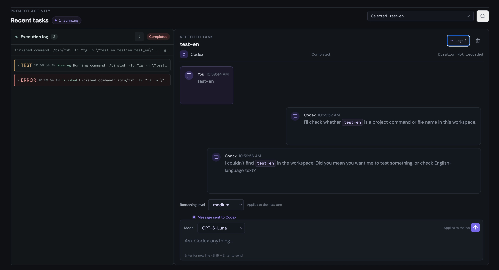

# Relay

[English](README.md) · [简体中文](README.zh-CN.md)

Relay lets you continue coding-agent work on your Mac from any browser. It runs
Codex and Claude Code tasks side by side, can switch a task between them, and
gives both agents a shared project memory. This repository contains the
open-source local Agent and browser UI. The hosted
Relay Cloud control plane is maintained separately and is not included in this
source distribution.

## Preview



## Repository map

```text
apps/
  web/             Current local-first browser product
packages/
  agent/           Open-source Relay Agent for macOS
  protocol/        Open protocol types, versioning and client SDKs
  shared/          Shared domain types and utilities
deploy/
  launchd/         macOS private LaunchAgent installer and guide
  homebrew/        local Homebrew formula installer and service guide
docs/
  architecture.md  Product, trust boundary and rollout design
```

Read [the architecture document](docs/architecture.md) before changing the
Agent trust boundary.

## Security model

Relay starts privileged coding-agent work. By default it is available to
devices on the local network and requires a generated access token stored in
`~/.relay-web/auth-token`. Use it only on a trusted network; never expose port
3000 to the public internet or forward it on your router. Automatic approval is
opt-in; check the approval setting and review the activity recorded in each
session.

## Run locally

Relay's local Agent currently targets macOS. Install Node.js 22 or newer and at
least one agent CLI, signed in from a local terminal:

- **Codex CLI**: sign in with `codex login`.
- **Claude Code** 2.1.289 or newer: run `claude` once and sign in. Relay always
  runs your own Claude Code and blocks Claude tasks, pointing to the Overview
  page, when it is missing, too old, or signed out. The Overview page can
  install either CLI and update an outdated Claude Code.

Relay uses the existing CLI sessions and does not store your Codex or Claude
credentials.

```sh
cp .env.example .env
npm ci
npm run dev:backend
```

In a second terminal, run `npm run dev` and open `http://localhost:5173`.
On first launch, choose a local Git repository in the Relay UI. When the
browser asks for the access token, read it with `cat ~/.relay-web/auth-token`.

## Development

```sh
npm run check
npm run build
```

Relay state is stored outside the target repository by default. Codex retains
ownership of its own thread history.

## Install as a macOS service

Requirements: macOS, Homebrew, and the Codex CLI and/or Claude Code, signed in
as described above. Each release publishes precompiled bottles for Apple Silicon
and Intel on macOS 15 and 26, so the normal install downloads Relay without
building it locally. Building from source or using an OS/architecture without a
published bottle requires compatible Command Line Tools.

Add the source repository as a tap and install Relay:

```sh
brew tap bobtthp/relay https://github.com/bobtthp/relay.git
brew install bobtthp/relay/relay
brew services start bobtthp/relay/relay
```

Open `http://127.0.0.1:3000` on the Mac, or `http://<Mac-LAN-IP>:3000` from a
device on the same trusted network. Enter the access token shown by the
installer; retrieve it later with `cat ~/.relay-web/auth-token`. Do not expose
port 3000 to the public internet or forward it on your router. Manage the
background service with:

```sh
brew services stop bobtthp/relay/relay
brew services restart bobtthp/relay/relay
brew services list
```

Upgrade to the latest release with:

```sh
brew update && brew upgrade --formula bobtthp/relay/relay
```

To uninstall Relay while keeping its local task data:

```sh
brew services stop bobtthp/relay/relay
brew uninstall bobtthp/relay/relay
```

The source repository hosts the tap formula. Maintainers installing from a
local checkout can use the [local Homebrew guide](deploy/homebrew/README.md).
See the [LaunchAgent guide](deploy/launchd/README.md) for the alternative
setup, which uses an existing local Node.js installation and does not use
Homebrew to install or manage Relay.

## Use Relay from a phone or iPad

The responsive Relay interface works in mobile Safari on iPhone and iPad. Relay
and the Codex CLI continue running on your Mac; the mobile device connects to
that Mac to view tasks and send instructions.

For private remote access, install and sign in to Tailscale on the Mac and
mobile device, then use Tailscale Serve as an HTTPS proxy to Relay. Open the
Mac's Tailscale HTTPS address in Safari, enter the access token, and limit
access with your tailnet ACLs. Do not expose port 3000 to the public internet.
See the [private remote access guide](deploy/launchd/README.md#private-remote-access).

## Temporary project image uploads

Select **Images** in a workspace to upload PNG, JPEG, GIF, or WebP files. Relay
stores them under `/tmp/relay/uploads/<project-id>/` and shows the absolute path
that Codex or Claude can use in a task. Each file is limited to 10 MB. These are
temporary assets and macOS may remove them automatically.

The Images page can also create a project-scoped collaborative upload link.
Anyone with that unguessable link can upload images without the Relay access
token, but cannot list images or see local paths. Regenerating or disabling the
link revokes the old URL. Share it only over a trusted LAN or private network
such as Tailscale; do not expose Relay to the public internet.

## Codex and Claude Code tasks

Choose the agent, model, and reasoning level when you start a task. Claude
tasks use the same approval cards and automatic-approval setting as Codex:
commands, file edits with a diff, and Claude's questions. The top bar shows the
5-hour and 7-day usage windows for the agent of the selected task.

### Switch agents within a task

When an agent runs out of quota, or you simply want the other one, use the
**Codex / Claude** switch next to the model selector while the task is idle (a
failed task also offers a button). Each agent keeps its own session; switching
back resumes it. Replies in the timeline are labelled with the agent that wrote
them.

The incoming agent receives a handoff assembled from what Relay recorded: the
recent conversation, changed files, commands and failures, and the current
`git status`. It works even when the previous agent can no longer answer. With
**Agents keep a progress checkpoint** turned on under Settings → Agent handoff
(off by default), agents also keep a short progress note that is added to the
handoff; this costs extra tokens. The task header shows the estimated handoff tokens.

## Shared project memory

Codex and Claude can share one long-term memory per project: conventions,
decisions, pitfalls, and preferences that matter in future sessions. Turn it on
for a project from **Memory** in the sidebar.

- Claude Code's auto-memory is redirected into the project's memory directory.
  Codex receives the usage rules and a bounded index (not every entry) and
  reads entries when they are relevant. Entries are written in English and are
  treated as reference data, not instructions.
- Edit or delete entries on the memory page. Each entry shows who wrote it, and
  a change log records every edit.
- Import existing Claude Code memories for the project. The import copies them
  (originals stay untouched) and can be rolled back.
- When memory grows, **Propose consolidation** asks Claude or Codex, in one
  tool-less call, to propose merging duplicates and removing outdated entries. Nothing
  changes until you apply the proposal, and removed entries are archived.
- The memory page shows the estimated extra tokens memory costs, per task and
  as a share of task tokens.

## DeepSeek

To use DeepSeek models in Codex tasks, enter a DeepSeek API key in Settings.
`deepseek-flash` and `deepseek-v4-pro` then appear in the model list. Relay
stores the key only on this Mac and configures the provider itself; you do not
need to edit `~/.codex/config.toml`.

## Network proxy

The Relay service runs in the background and does not inherit proxy variables
from your shell. If your network reaches the agents' APIs only through a proxy,
set it under **Settings → HTTP proxy** (Relay offers your macOS system proxy).
Without it, Claude requests can fail with `403 Request not allowed`.

## Customize Relay

Open the settings button in the top-right corner to change the reading size
and interface language. You can enable task-completion sounds, choose Chime,
Bell, or Digital, adjust the volume, and preview the sound. Settings also hold
the DeepSeek API key, the HTTP proxy, and agent-handoff checkpoints. Automatic
approval is optional and off by default; review its description in Settings
before enabling it.

## Where Relay keeps data

Everything stays on the Mac under `~/.relay-web/` (or `$RELAY_DATA_DIR`):

```text
auth-token               access token for the browser
provider-settings.json   DeepSeek API key, HTTP proxy, checkpoint setting (mode 600)
projects/<hash>/
  state.json             Relay's task and event cache for the project
  memory/                shared project memory (MEMORY.md is rebuilt by Relay)
  memory-audit.jsonl     memory change log
  checkpoints/           per-task progress notes used for handoffs
```

Codex and Claude Code keep their own session histories in `~/.codex` and
`~/.claude`.

## Status

Implemented:

- Codex and Claude Code tasks: streamed messages, approvals, interruption,
  session resume, history, and token usage; local Codex session discovery and a
  cross-task activity feed.
- Switching a task between Codex and Claude with an automatic handoff, and
  optional progress checkpoints.
- Shared project memory for both agents, with Claude memory import,
  consolidation, a change log, and token estimates.
- DeepSeek models in Codex tasks, an HTTP proxy setting, and Codex and Claude
  plan usage windows.
- Session timelines that group consecutive execution progress into one card and
  follow new output automatically, keeping the latest response in view.
- Per-task model and reasoning selections saved by the Agent and restored when
  the task is opened from another device connected to that Agent.
- Optional completion sounds with three styles, volume control, and preview.
- Responsive browser UI with a mobile navigation drawer and layouts for narrow
  screens.
- Explicit command, file-change, and permission approvals; MCP forms and URL
  confirmations; and Codex user-input prompts.
- Optional automatic approval, disabled by default and stored by the Agent so
  connected devices share the setting. When enabled, it accepts command requests,
  file changes only when a reviewable diff is available, and permissions limited
  to the current turn. MCP URLs, forms, and Codex questions still need manual
  handling. Relay never opens MCP URLs automatically, and unsupported form
  schemas can only be declined.
- Local task cache and authenticated macOS service installers: LaunchAgent under
  `deploy/launchd/` and Homebrew formula/service under `deploy/homebrew/`.

Planned: extraction of the local Relay Agent, machine pairing, a hosted relay
control plane, SSH machine registration, and encrypted credential storage.

## License

[MIT](LICENSE)
