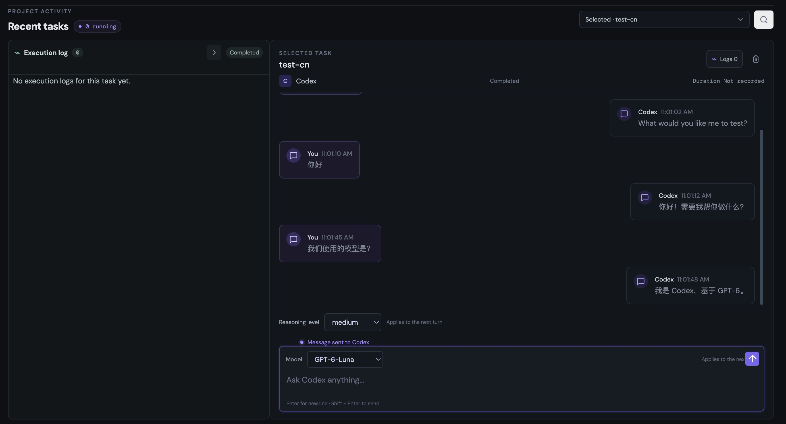

# Relay

[English](README.md) · [简体中文](README.zh-CN.md)

Relay 让你通过浏览器继续在 Mac 上使用编程 Agent。它可以同时运行 Codex 和
Claude Code 任务，在同一个任务里切换两者，并让它们共享项目记忆。当前仓库包含
本地开源 Agent 和浏览器页面；托管版 Relay Cloud 控制平面单独维护，不包含在此源码发布中。

## 界面预览



## 仓库结构

```text
apps/
  web/             当前的本地优先浏览器产品
packages/
  agent/           面向 macOS 的开源 Relay Agent
  protocol/        开放协议类型、版本管理和客户端 SDK
  shared/          共享领域类型和工具
deploy/
  launchd/         macOS LaunchAgent 安装脚本和指南
  homebrew/        本地 Homebrew Formula 安装脚本和服务指南
docs/
  architecture.md  产品、信任边界和发布计划
```

更改 Agent 信任边界前，请先阅读[架构文档](docs/architecture.md)。

## 安全模型

Relay 可以启动会读取和修改本地代码仓库的编程 Agent。默认情况下，同一局域网内的
设备可以访问服务，并需要输入访问令牌；令牌保存在 `~/.relay-web/auth-token`。
请只在可信局域网中使用，绝不要将 3000 端口暴露到公网或配置路由器端口转发。
自动批准为可选功能，默认关闭；开启后请检查设置，并查看各会话中记录的活动。

## 本地运行

本地 Relay Agent 目前面向 macOS。请安装 Node.js 22 或更新版本，以及至少一个
Agent CLI，并在本地终端完成登录：

- **Codex CLI**：运行 `codex login` 登录。
- **Claude Code** 2.1.289 或更新版本：运行一次 `claude` 并登录。Relay 始终使用
  本机安装的 Claude Code；未安装、版本过旧或未登录时，Claude 任务会被拦下，并
  提示前往概览页处理。概览页可以安装这两个 CLI，也可以更新过旧的 Claude Code。

Relay 使用现有的 CLI 登录状态，不会保存 Codex 或 Claude 的凭据。

```sh
cp .env.example .env
npm ci
npm run dev:all
```

这个命令会同时启动前后端；按 Ctrl+C 会一起停止。前端地址是
`http://localhost:5173`。首次打开时，在 Relay 界面中选择一个本地 Git 仓库。
浏览器要求访问令牌时，在终端运行 `cat ~/.relay-web/auth-token` 查看。

## 开发

```sh
npm run check
npm run build
```

Relay 状态默认保存在目标仓库之外。Codex 仍负责管理自己的会话历史。

## 安装为 macOS 服务

需要 macOS、Homebrew，以及按上文登录好的 Codex CLI 和/或 Claude Code。每个版本都会
为 macOS 15 和 26 上的 Apple Silicon 与 Intel 发布预编译 bottle，正常安装可直接下载
Relay，无需在本机构建。若从源码安装，或当前 macOS/架构没有对应 bottle，则需要兼容的
Command Line Tools。

先将源码仓库添加为 tap，再安装并启动服务：

```sh
brew tap bobtthp/relay https://github.com/bobtthp/relay.git
brew install bobtthp/relay/relay
brew services start bobtthp/relay/relay
```

安装后，在 Mac 上打开 `http://127.0.0.1:3000`，或在同一可信局域网的设备上打开
`http://<Mac局域网IP>:3000`。按安装提示输入访问令牌，也可以运行
`cat ~/.relay-web/auth-token` 再次查看。不要将 3000 端口暴露到公网或配置路由器端口转发。
使用以下命令管理后台服务：

```sh
brew services stop bobtthp/relay/relay
brew services restart bobtthp/relay/relay
brew services list
```

升级到最新版本：

```sh
brew update && brew upgrade --formula bobtthp/relay/relay
```

卸载 Relay 但保留本地任务数据：

```sh
brew services stop bobtthp/relay/relay
brew uninstall bobtthp/relay/relay
```

源码仓库本身托管 tap 公式。维护者从本地源码安装可参考 [Homebrew 本地安装指南](deploy/homebrew/README.md)；
另一种安装方式见 [LaunchAgent 指南](deploy/launchd/README.md)，它使用本机已有的
Node.js，不需要 Homebrew 来安装或管理 Relay。

## 使用手机或 iPad 远程操作

Relay 页面适配手机和 iPad 的 Safari。Relay 和 Codex CLI 仍在 Mac 上运行，
手机或 iPad 连接这台 Mac 后即可查看任务并发送指令。

如需私密远程访问，请在 Mac 和移动设备上安装并登录 Tailscale，再使用
Tailscale Serve 通过 HTTPS 访问 Relay，并在 Relay 页面输入访问令牌。
通过 tailnet ACL 限制可访问成员；不要将 3000 端口暴露到公网或配置路由器端口转发。详见
[私密远程访问指南](deploy/launchd/README.md#private-remote-access)。

## Codex 与 Claude Code 任务

新建任务时选择 Agent、模型和推理级别。Claude 任务和 Codex 使用同样的审批卡片和
自动批准设置，包括命令、带差异的文件修改以及 Claude 的提问。顶栏会显示当前任务所用
Agent 的 5 小时和 7 天额度。

### 在同一任务中切换 Agent

当一个 Agent 额度用完，或者你想换另一个时，在任务空闲时使用模型选择左侧的
**Codex / Claude** 切换按钮（任务失败时也会出现切换按钮）。两个 Agent 各自保留会话，
切换回来会接着原来的会话继续。时间线中的每条回复都会标明是哪个 Agent 写的。

接手的 Agent 会收到 Relay 根据记录整理的交接内容：最近的对话、改动过的文件、执行过
的命令和失败记录，以及当前的 `git status`。即使上一个 Agent 已经无法回应，也能完成
交接。在“设置 → 切换 Agent”中打开 **让 Agent 记录进度检查点**（默认关闭）后，
Agent 还会在工作中维护一份简短的进度笔记，并附在交接内容里；这会额外消耗 token。
任务信息栏会显示交接所用的估算 token。

## 共享项目记忆

Codex 和 Claude 可以为每个项目共享一份长期记忆，用来保存以后的会话也需要的约定、
决策、注意事项和偏好。在侧边栏的 **共享记忆** 中为项目开启。

- Claude Code 的自动记忆会被重定向到该项目的记忆目录。Codex 会收到使用规则和一份
  有长度上限的索引（而不是全部条目），在需要时再读取具体条目。记忆统一用英文写，
  并被当作参考资料而不是指令。
- 在记忆页可以编辑和删除条目。每条记忆都会显示作者，变更记录会保存每一次修改。
- 可以导入该项目已有的 Claude Code 记忆。导入只会复制（原文件保持不动），并且可以回滚。
- 记忆变多后，点击 **生成整理建议**，由 Claude 或 Codex 在一次不使用工具的调用中提出
  合并重复、删除过时条目的建议。只有你确认应用后才会修改，被删除的条目会归档。
- 记忆页会显示记忆带来的额外 token（估算），包括每个任务的数值和占任务总 token 的比例。

## DeepSeek

如需在 Codex 任务中使用 DeepSeek 模型，在设置中填写 DeepSeek API Key，模型列表就会
出现 `deepseek-flash` 和 `deepseek-v4-pro`。Key 只保存在本机，Relay 会自动配置
provider，不需要修改 `~/.codex/config.toml`。

## 网络代理

Relay 服务在后台运行，不会继承终端里的代理环境变量。如果你的网络需要通过代理才能
访问 Agent 的 API，请在 **设置 → 网络代理** 中设置（Relay 会提供 macOS 系统代理作为
选项）。不设置的话，Claude 请求可能会以 `403 Request not allowed` 失败。

## 自定义 Relay

点击页面右上角的设置按钮，可以调整阅读字号和界面语言。你也可以开启任务
完成提示音，在清脆、铃声和电子音之间选择，调节音量并试听。DeepSeek API Key、
网络代理和交接检查点也在设置中。自动批准为可选功能，默认关闭；开启前请先阅读
设置中的说明。

## 数据存放位置

所有数据都保存在本机的 `~/.relay-web/`（或 `$RELAY_DATA_DIR`）下：

```text
auth-token               浏览器访问令牌
provider-settings.json   DeepSeek API Key、网络代理、检查点设置（权限 600）
projects/<hash>/
  state.json             该项目的 Relay 任务与事件缓存
  memory/                共享项目记忆（MEMORY.md 由 Relay 重建）
  memory-audit.jsonl     记忆变更记录
  checkpoints/           交接用的各任务进度笔记
```

Codex 和 Claude Code 各自的会话历史分别保存在 `~/.codex` 和 `~/.claude`。

## 状态

已实现：

- Codex 与 Claude Code 任务：流式消息、审批、中断、会话恢复、历史记录和 token 用量；
  本地 Codex 会话发现和跨任务活动流。
- 在 Codex 与 Claude 之间切换任务并自动交接，以及可选的进度检查点。
- 两个 Agent 共享的项目记忆，支持导入 Claude 记忆、整理记忆、变更记录和 token 估算。
- Codex 任务可使用 DeepSeek 模型，支持网络代理设置，并显示 Codex 与 Claude 的额度窗口。
- 会话时间线会将连续的执行进度合并到同一张卡片，并在新内容到达时自动滚动，
  让最新回复保持在视野中。
- 每个任务的模型和推理强度由 Agent 保存；其他连接到该 Agent 的设备打开任务时，
  会恢复对应设置。
- 可选的任务完成提示音，支持三种音效、音量调节和试听。
- 适配手机的浏览器界面，包括移动导航抽屉和窄屏布局。
- 命令、文件修改和权限审批；MCP 表单与 URL 确认；Codex 用户输入问题。
- 可选的自动批准功能，默认关闭，并由 Agent 保存设置供已连接设备共享。开启后，
  Relay 会自动批准命令请求、有可审阅差异的文件修改，以及仅对当前轮生效的权限。
  MCP URL、表单和 Codex 提问仍需手动处理。Relay 不会自动打开 MCP URL；不支持的
  表单结构只能拒绝。
- 本地任务缓存，以及 macOS 服务安装方式：`deploy/launchd/` 中的
  LaunchAgent 和 `deploy/homebrew/` 中的 Homebrew Formula/服务。

计划中：抽离独立的本地 Relay Agent、设备配对、托管控制平面、SSH 设备注册和
加密凭据存储。

## 许可证

[MIT](LICENSE)
